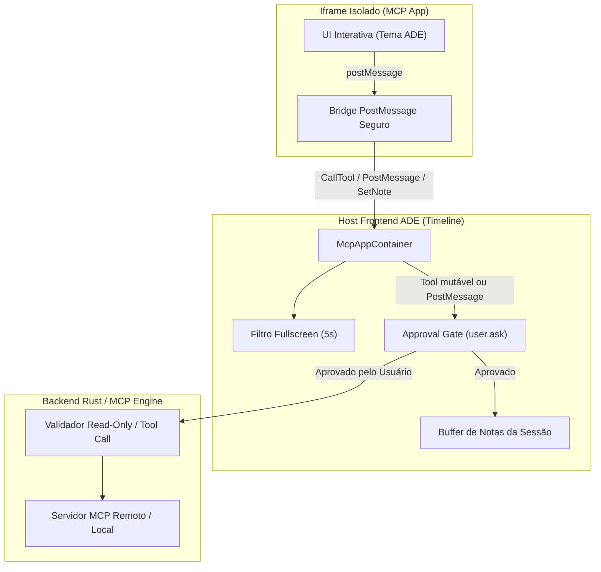

# Plano de Paridade 7.2: MCP Apps

Plano técnico e arquitetural para a entrega **7.2 MCP Apps** da Fase 7 da auditoria de paridade entre o ADE AGS e o T3 Code.

---

## 1. O que o T3 Code faz (com citações)

Referência auditada: [`docs/user/html-renders.md`](https://github.com/pingdotgg/t3code/blob/main/docs/user/html-renders.md) (linhas 295 a 312).

### 1.1 Suporte ao padrão MCP Apps e renderização na timeline
O T3 Code implementa a extensão MCP Apps ([`modelcontextprotocol/ext-apps`](https://github.com/modelcontextprotocol/ext-apps)). Servidores MCP retornam uma aplicação web interativa junto com os resultados de ferramentas:
> *"Some MCP servers return an interactive app with their tool results, following the MCP Apps standard (https://github.com/modelcontextprotocol/ext-apps). When an agent calls one of those tools, the app appears in the thread in place of the tool call, on web, desktop, and mobile. Codex and Claude support this today, for any MCP server you have configured for them. Claude needs Claude Code 2.1.301 or newer; older versions and other providers show these calls as ordinary tool calls."* (`html-renders.md`, linha 310)

### 1.2 Tema, approvals de ações e contenção de navegação
Os apps herdam a aparência da aplicação, mas toda ação que gera efeitos externos ou mensagens requer consentimento prévio:
> *"Apps follow your theme. An app can call tools on its own server and post a message to the thread; T3 Code asks first unless the server marks the tool as read-only, and it asks before every message. On mobile, an app also asks before opening a link, and T3 Code asks before saving a file an app offers. An app stays viewable after its agent stops, but using it needs the agent of the thread that created it running, so send a message in that thread first if the app says it is unavailable. An app that navigates away from its own page is stopped."* (`html-renders.md`, linha 311)

### 1.3 Tela cheia protegida, saída previsível e feedback ao agente
O T3 Code protege a pessoa usuária contra cliques acidentais e garante retorno imediato à conversa:
> *"An app can open full screen right after you tap or click in it. On web and desktop, a tap in the app within five seconds of a click or key press elsewhere in T3 Code doesn't count, so tap it again after that. Use the button in its top corner, or press Escape outside the app, to return it to the thread. Anything else that needs your attention, such as an approval, also returns it to the thread. On mobile, full screen opens the app again in its own screen, so anything the app does not save itself starts over. An app can also keep the agent informed of what you did in it, such as a filter you picked; T3 Code sends the latest note from each app with your next message."* (`html-renders.md`, linha 312)

### 1.4 Isolamento e bloqueio de rede local
Da seção de prévias gerais do T3 Code:
> *"Pages use your current theme, including custom themes, and follow light and dark mode as you switch. Scripts run inside the page, but it is sandboxed away from T3 Code and your session. Links you click in a page open in your browser."* (`html-renders.md`, linha 296)
> *"Previews can load public resources such as CDN scripts, but nothing on your local network. The machine running the environment looks up each name, and previews block names that resolve to private or reserved addresses."* (`html-renders.md`, linha 299)

---

## 2. O que a ADE já tem (com arquivo e linha)

Auditado diretamente no código-fonte da ADE:

1. **Prévia visual isolada de blocos HTML (estática):**
   - [`src/features/chat/timeline/VisualReplyPreview.tsx`](../../src/features/chat/timeline/VisualReplyPreview.tsx#L10-L47): a função `appThemeDeclarations()` (linhas 10–24) extrai e sanitiza os tokens de tema CSS (`COLOR_TOKENS`, `FONT_TOKENS`), rejeitando caracteres perigosos como `<>;{}`.
   - [`src/features/chat/timeline/VisualReplyPreview.tsx`](../../src/features/chat/timeline/VisualReplyPreview.tsx#L26-L47): `visualReplyDocument(html)` monta um documento HTML com CSP restritiva (`default-src 'none'; connect-src 'none'; img-src data: blob:; style-src 'unsafe-inline' data:; script-src 'unsafe-inline'; frame-src 'none'; form-action 'none'; navigate-to 'none'`) e injeta script para interceptar e prevenir navegação por cliques em `a[href]` (linhas 45–46).
   - [`src/features/chat/timeline/VisualReplyPreview.tsx`](../../src/features/chat/timeline/VisualReplyPreview.tsx#L49-L74): o componente `VisualReplyPreview` renderiza a página em um modal `ViewModal` com `<iframe sandbox="allow-scripts" referrerpolicy="no-referrer" srcDoc={...} />`.
   - [`src/features/chat/timeline/CodeBlockFrame.tsx`](../../src/features/chat/timeline/CodeBlockFrame.tsx#L8-L62): exibe a ação explícita de "Visualizar" apenas para blocos de código com linguagem `html`/`htm`, abrindo o modal.

2. **Isolamento de iframe de Canvas e Pranchetas de Design:**
   - [`src/features/canvas/design/srcdoc.ts`](../../src/features/canvas/design/srcdoc.ts#L79-L103): constrói documentos para pranchetas em sandbox sem `allow-same-origin`.
   - [`src/features/design/frameBridge.ts`](../../src/features/design/frameBridge.ts#L1-L6): estabelece canal de mensagens hostil/filtrado entre o app e as pranchetas via eventos de ponte.

3. **Servidor MCP e Ferramentas da ADE:**
   - [`src-tauri/src/ipc/mcp.rs`](../../src-tauri/src/ipc/mcp.rs#L1-L26): servidor stdio JSON-RPC 2.0 que conecta agentes de IA ao backend da ADE via protocolo IPC local.
   - [`src-tauri/src/ipc/mcp.rs`](../../src-tauri/src/ipc/mcp.rs#L31-L41): broker de aprovação de ferramentas (`approve_tool_use`) com timeout humano configurável (`APPROVAL_TIMEOUT_SECS = 3600`).
   - [`src-tauri/src/ipc/mcp.rs`](../../src-tauri/src/ipc/mcp.rs#L63-L98): contexto MCP escopado para tarefas headless (`Task`) ou abas interativas (`Cwd`).
   - [`src-tauri/src/ipc/mcp.rs`](../../src-tauri/src/ipc/mcp.rs#L240-L501): ferramentas de navegador (`browser_navigate`, `browser_snapshot`, `browser_click`, etc.) operam apenas com saídas estruturadas de texto, JSON e screenshots. Não há suporte a MCP Apps nem a `html_render` ou `html_preview`.

4. **Ponte de Comandos do Orquestrador e Diálogos de Aprovação:**
   - [`src/features/orchestrator/cliBridge.ts`](../../src/features/orchestrator/cliBridge.ts#L522-L538): despacha comandos de backend para as stores do frontend, incluindo `user.ask` (linha 526) e `user.secret` (linha 527).
   - [`src/features/ask/askStore.ts`](../../src/features/ask/askStore.ts#L15): gerencia o estado e as confirmações de ações pendentes que dependem de decisão da pessoa usuária.

---

## 3. A Lacuna

1. **Protocolo MCP Apps Ausente:** O servidor MCP da ADE e os adaptadores de provedores não reconhecem metadados de UI / extensão de apps (`modelcontextprotocol/ext-apps`). Se um servidor MCP externo retornar uma aplicação interativa empacotada no tool result, a ADE a descarta ou renderiza apenas texto cru.
2. **Falta de Renderização Integrada na Timeline:** Atualmente, a ADE só tem o `VisualReplyPreview`, que abre em um modal flutuante (`ViewModal`) disparado manualmente a partir de blocos Markdown ```html. Falta um contêiner embutido que renderize o app interativo no corpo da conversa, exatamente no local da chamada da ferramenta.
3. **Ausência de Canal RPC Bidirecional Seguro:** Falta um protocolo bidirecional para que o app MCP solicite:
   - Invocação de ferramentas no seu próprio servidor MCP (com verificação se a ferramenta é `read-only` ou se requer aprovação);
   - Envio de mensagens para a conversa da thread (com confirmação humana obrigatória);
   - Registro de notas de contexto (`latest note`) para serem anexadas à próxima fala do usuário.
4. **Falta de Política de Ciclo de Vida e Contenção:**
   - Não há detecção ou interrupção quando o app tenta navegar para fora de sua página.
   - Não há acoplamento de vivacidade entre o app interativo e a sessão do agente que o gerou.
5. **Falta de Controle Seguro de Tela Cheia:**
   - Não há proteção contra ativação involuntária de tela cheia (janela de 5 segundos após cliques fora).
   - Não há retorno automático para a conversa ao pressionar `Escape` ou quando uma solicitação de aprovação exige atenção humana.

---

## 4. Desenho Proposto em Fatias Pequenas



### Fatia 1: Reconhecimento do Contrato MCP Apps e Parser de Respostas de Ferramentas
- **Escopo:** Extensão no parser de respostas de chamadas MCP para identificar payloads de MCP Apps (`application/vnd.mcp.app+html` ou formato ext-apps).
- **Alterações:** Mapeamento em `src-tauri/src/ipc/mcp.rs` ou nas conversas estruturadas (`src/features/chat/structured/`) para encapsular o HTML do app junto ao `tool_use_id`.
- **Comportamento:** Se o provedor ou versão não suportar MCP Apps, fallback limpo para a visualização padrão de tool call.

### Fatia 2: Contêiner Inline `McpAppFrame` com Sandbox e Tema
- **Escopo:** Componente visual para a timeline do chat substituindo a caixa rígida de tool call quando há app interativo.
- **Isolamento:**
  - `<iframe sandbox="allow-scripts" referrerpolicy="no-referrer" srcDoc={...}>`
  - CSP rigorosa: `default-src 'none'; script-src 'unsafe-inline'; style-src 'unsafe-inline'; img-src data: blob: https:; connect-src 'none'; form-action 'none'; base-uri 'none'; frame-src 'none'; navigate-to 'none'`.
  - Injeção das variáveis de tema CSS da ADE (`appThemeDeclarations()` já validado em `VisualReplyPreview.tsx` L10-24).
- **Contenção de Navegação:** Interceptar eventos de clique em `<a>`, submissões de formulário e tentativas de alteração de `window.location`. Qualquer tentativa de navegação fora da página interrompe e desmonta o app imediatamente, exibindo banner informativo.

### Fatia 3: Canal RPC Bidirecional com Gate de Aprovação para Ferramentas e Mensagens
- **Escopo:** Ponte via `postMessage` entre o iframe e o componente `McpAppFrame`.
- **Protocolo de Comunicação:**
  - `callTool(name, arguments)`: app solicita executar tool em seu próprio servidor.
  - `postMessage(text)`: app solicita enviar mensagem para a thread.
  - `setContextNote(note)`: app informa estado ou seleção feita pelo usuário.
- **Aprovações Obrigatórias:**
  - Se a ferramenta do servidor MCP estiver declarada com anotação explícita de `read-only`, executa sem prompt adicional.
  - Para qualquer outra ferramenta mutável, invoca o sistema de aprovação existente da ADE (`user.ask`), parando a execução até confirmação expressa da pessoa usuária.
  - Antes de postar qualquer mensagem na timeline, exibe um diálogo com pré-visualização do texto exato e botões "Enviar" e "Descartar".

### Fatia 4: Feedback ao Agente via Buffer de Notas (`Latest Note`)
- **Escopo:** Armazenamento em memória na conversa ativa das últimas anotações geradas por cada MCP App ativo.
- **Comportamento:**
  - O app atualiza notas usando `setContextNote` (ex.: `{ "filtro_selecionado": "status=ativo" }`).
  - O composer da conversa anexa o snapshot mais recente dessas notas no próximo envio da pessoa usuária, rotulado estritamente como dado não confiável (`UNTRUSTED_APP_CONTEXT`).
  - Não envia nada autonomamente para o modelo de linguagem.

### Fatia 5: Gerenciamento de Tela Cheia com Guardas e Ciclo de Vida Vinculado
- **Escopo:** Modo tela cheia para o app interativo dentro da janela da ADE.
- **Guardas contra Ativação Involuntária (Anti-Clickjacking):**
  - Cliques ou toques ocorridos nos primeiros 5 segundos após eventos de mouse ou teclado fora do contêiner do app são ignorados para a transição de tela cheia.
- **Saída Previsível:**
  - Botão fixo no canto superior ("Voltar à conversa").
  - Pressionar a tecla `Escape` fora de inputs recolhe o app imediatamente.
  - Qualquer solicitação de aprovação pendente (permissão de tool, confirmação de mensagem) forçadamente desativa a tela cheia para revelar o prompt na timeline.
- **Vivacidade:**
  - Se o agente da conversa parar ou a sessão for encerrada, o app continua legível em modo somente-leitura; qualquer tentativa de chamar tools exibe aviso para retomar o agente da conversa primeiro.

---

## 5. Riscos de Segurança e Privacidade e Mitigações

| Risco | Gravidade | Mitigação Arquitetural |
|---|---|---|
| **Escape de Sandbox / XSS contra a ADE** | Crítica | Iframe com sandbox sem `allow-same-origin`. O app roda com origem opaca `null`. Tokens de autenticação IPC da ADE (`~/.ags/ipc.json`), segredos e APIs Tauri ficam completamente inacessíveis. |
| **Injeção de Instruções via Mensagens Autônomas** | Alta | Um app MCP nunca pode escrever diretamente no histórico do chat sem consentimento humano explícito. Cada mensagem exige aprovação humana com revisão de texto na UI. |
| **Execução Não Autorizada de Ferramentas** | Alta | O app só pode invocar ferramentas do seu próprio servidor MCP de origem. Ferramentas que causam mutação exigem autorização via broker de permissões (`user.ask`). |
| **SSRF e Varredura de Rede Local** | Alta | Bloqueio de conexões para IPs privados/reservados (RFC 1918) e loopback direto a partir do app MCP. A CSP padrão impõe `connect-src 'none'`, exigindo que dados transitem apenas pelo protocolo MCP autorizado. |
| **Clickjacking / Sequestro de Foco em Tela Cheia** | Média | Debounce de 5 segundos sem eventos externos antes de permitir transição para tela cheia; desarme instantâneo com `Escape` ou na chegada de qualquer aprovação. |
| **Navegação Maliciosa / Phishing** | Média | Tentativas de navegação externa ou desvio da página original causam desligamento imediato do app (`navigate-to 'none'`, listener de descarregamento). Links externos abrem exclusivamente no navegador padrão do sistema. |

---

## 6. Testes que Provam Cada Fatia

1. **Teste de Sandbox e CSP (Vitest):**
   - Validar que o documento gerado para o app MCP contém a CSP estrita, sem diretivas permissivas e sem `allow-same-origin`.
   - Garantir que links `<a>` com `href` externo tenham seu comportamento padrão cancelado e não alterem o frame.
2. **Teste da Fila de Aprovações e Tool Calls (Vitest / Rust):**
   - Simular mensagem `callTool` vinda do iframe para tool declarada como `read-only`: deve despachar diretamente.
   - Simular mensagem `callTool` para tool sem anotação: deve disparar evento de aprovação e permanecer pausada até o OK da pessoa usuária.
   - Simular mensagem `postMessage`: deve aguardar confirmação visual antes de enviar.
3. **Teste do Buffer de Notas de Contexto (Vitest):**
   - Atualizar a nota do app três vezes consecutivas; confirmar que apenas a última nota (`latest note`) é incluída no payload de envio da próxima fala da pessoa usuária.
4. **Teste de Proteção de Tela Cheia (Vitest):**
   - Simular clique dentro do app com menos de 5 segundos após evento de tecla global: a transição para tela cheia deve ser recusada.
   - Simular disparo de aprovação (`user.ask` pendente): estado de tela cheia deve ser resetado para `false`.
5. **Teste de Interrupção por Navegação:**
   - Simular evento de navegação ou alteração de hash/URL não autorizada: verificar se o componente entra no estado de erro `stopped_navigated_away` e desmonta o frame.

---

## 7. O que Exige OK Explícito do Usuário Antes de Implementar

1. **Aprovação da Política de Ferramentas Read-Only:** Decidir se ferramentas marcadas no servidor MCP como somente leitura podem de fato ser disparadas pelo app sem caixa de confirmação ou se a política padrão da ADE deve manter aprovação para tudo.
2. **Definição de Conectividade de Rede para Recursos de Apps:** Definir se a CSP do app MCP aceitará scripts externos de CDNs públicas confiáveis (como no T3 Code) ou se a ADE exigirá empacotamento estritamente local/autocontido (`connect-src 'none'` total).
3. **Comportamento em Telas Menores e Painéis Laterais:** Decidir se o contêiner MCP App poderá expandir a largura da timeline da conversa ou se deverá permanecer contido na largura atual do chat.
